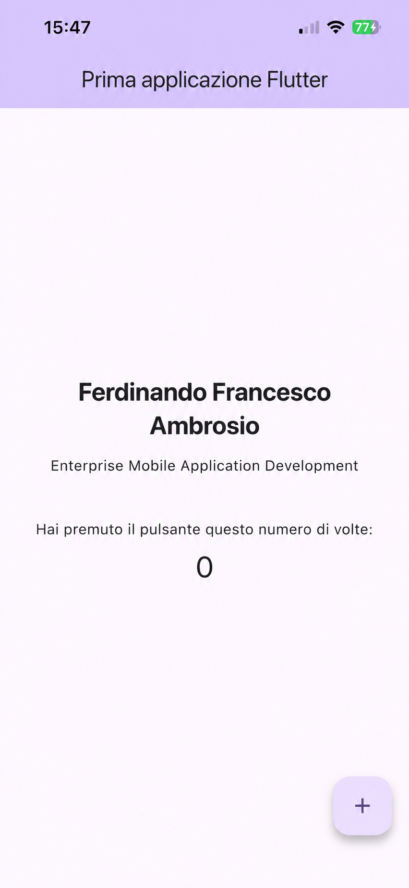

# Prima applicazione Flutter

Ferdinando Francesco Ambrosio
Enterprise Mobile Application Development — Università degli Studi di Salerno

Template Flutter personalizzato con il mio nome e cognome. Il pulsante `+` incrementa il contatore.

L'app è stata eseguita su un iPhone 13.

## Avvio

Con il telefono collegato:

```sh
flutter pub get
flutter run
```

## Test

```sh
flutter analyze
flutter test
```

## Screenshot


